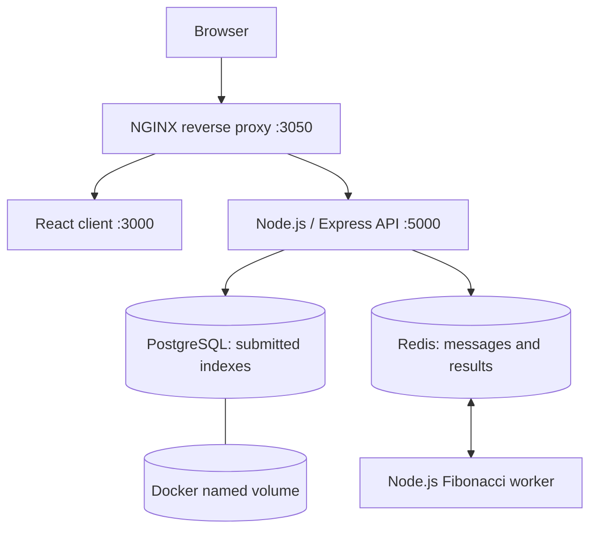

# Multi-Deployment Using Docker

[](https://github.com/4klud/multi-deployment-using-docker/actions/workflows/docker-ci.yml)

A multi-container **Fibonacci calculator** built with React, Node.js/Express, PostgreSQL, Redis, a background worker, and NGINX. Docker Compose runs the services locally, while GitHub Actions builds the images and verifies the application workflow automatically.

> **Project status:** Local Docker deployment and GitHub Actions CI are working. AWS deployment is planned, not yet implemented in the modernized setup.

## Architecture



**Request flow:** The user submits an index in React. NGINX routes the API request to Express, which records the index in PostgreSQL and publishes work to Redis. The worker calculates the Fibonacci value and stores the result in Redis; the frontend retrieves submitted indexes and calculated results through the API.

## Tech stack

| Layer | Technology | Purpose |
| --- | --- | --- |
| Frontend | React | Input form and calculated results |
| Reverse proxy | NGINX | Routes browser and API traffic |
| API | Node.js / Express | Validates requests and coordinates storage |
| Database | PostgreSQL 18.6 | Persists submitted indexes |
| Messaging/results | Redis 8.10.3 | Exchanges work and stores computed results |
| Worker | Node.js | Computes Fibonacci values |
| Local orchestration | Docker Compose | Runs the six services |
| Continuous integration | GitHub Actions | Builds and integration-tests the stack |

## Prerequisites

- Docker Desktop or Docker Engine with Docker Compose v2
- Git
- `curl` for optional command-line API tests

Node.js does not need to be installed on the host to run the containerized application.

## Run locally

1. Clone the repository:

   ```bash
   git clone https://github.com/4klud/multi-deployment-using-docker.git
   cd multi-deployment-using-docker
   ```

2. Create a local environment file:

   ```bash
   cp .env.example .env
   ```

   Edit `.env` and set a local PostgreSQL password. The expected keys are:

   ```dotenv
   POSTGRES_USER=postgres
   POSTGRES_PASSWORD=replace_with_a_local_password
   POSTGRES_DB=postgres
   ```

   **Do not commit `.env`.** The `.env.example` file contains placeholders only. If you already have an initialized PostgreSQL volume, changing the password in `.env` alone does not update the existing database user's password.

3. Build and start the services:

   ```bash
   docker compose config --quiet
   docker compose up -d --build
   docker compose ps
   ```

4. Open **http://localhost:3050**.

5. Enter a Fibonacci index (for example, `8`) and submit. The application should display the submitted index and a calculated value of `34`.

### Stop the application

```bash
docker compose down
```

This stops and removes the Compose containers and network **without deleting the named PostgreSQL volume**. Avoid `docker compose down -v` unless you intentionally want to delete persisted development data.

## API examples

The API is available through NGINX at `http://localhost:3050/api`.

| Method | Endpoint | Description |
| --- | --- | --- |
| `GET` | `/api/` | Basic API response (`Hi`) |
| `GET` | `/api/values/all` | Previously submitted indexes from PostgreSQL |
| `GET` | `/api/values/current` | Calculated values from Redis |
| `POST` | `/api/values` | Submit an index for calculation |

Submit a calculation:

```bash
curl -i -X POST http://localhost:3050/api/values \
  -H 'Content-Type: application/json' \
  -d '{"index":10}'
```

The API acknowledges the request with `{"working":true}`. After the worker finishes, retrieve the result:

```bash
curl -s http://localhost:3050/api/values/current
```

The response should include `"10":"89"`.

View submitted indexes:

```bash
curl -s http://localhost:3050/api/values/all
```

The application rejects an index greater than `40` with HTTP `422`:

```bash
curl -i -X POST http://localhost:3050/api/values \
  -H 'Content-Type: application/json' \
  -d '{"index":41}'
```

## Persistence and service health

PostgreSQL uses a named Docker volume mounted at `/var/lib/postgresql`. The Compose configuration includes PostgreSQL and Redis health checks and dependency-aware startup for the API and worker.

Useful commands:

```bash
docker compose ps
docker compose logs --tail=100 api worker nginx
docker compose exec postgres pg_isready -U postgres -d postgres
docker compose exec redis redis-cli ping
```

For a development database backup (run from the repository root):

```bash
mkdir -p backups
docker compose exec -T postgres pg_dump -U postgres -d postgres > backups/postgres_backup.sql
```

Keep backups out of version control. Review restore procedures before replacing an existing database.

## Continuous integration

The [Docker CI workflow](.github/workflows/docker-ci.yml) runs on pull requests and pushes to `master`. It:

1. Validates the Compose configuration.
2. Builds the container images and starts the application.
3. Checks API readiness and PostgreSQL/Redis connectivity.
4. Submits a Fibonacci calculation and verifies the worker result and database record.
5. Tests invalid input and collects logs on failure.
6. Removes the temporary CI containers and volumes.

The badge at the top of this README reflects the default-branch workflow status. CI uses disposable test data and does not deploy to AWS.

## Repository layout

```text
multi-deployment-using-docker/
├── .github/workflows/docker-ci.yml
├── client/                 # React frontend
├── server/                 # Express API
├── worker/                 # Fibonacci background worker
├── nginx/                  # Reverse proxy configuration
├── docker-compose.yml      # Local six-service stack
├── .env.example            # Environment variable template
├── .gitignore
└── README.md
```

The repository also contains `Dockerrun.aws.json`, a **legacy Elastic Beanstalk deployment artifact**. It is not the current GitHub Actions deployment path.

## Troubleshooting

**Browser cannot reach the app:** Check `docker compose ps`, then inspect NGINX and client logs with `docker compose logs nginx client`.

**API returns 502:** Check `docker compose logs nginx api`. The modernized NGINX configuration uses Docker's internal DNS resolver to handle service-container IP changes.

**Database errors:** Verify that `.env` matches the credentials of your initialized PostgreSQL instance and check `docker compose logs postgres api`.

**No calculated value yet:** Check `docker compose logs worker redis` and retry the `GET /api/values/current` endpoint after a short delay.

## Roadmap

- [x] Restore the multi-container application locally
- [x] Pin PostgreSQL and Redis versions
- [x] Add PostgreSQL persistence and dependency health checks
- [x] Improve NGINX service discovery
- [x] Replace Travis CI with GitHub Actions integration testing
- [ ] Add broader frontend and API unit tests
- [ ] Add image/dependency vulnerability scanning
- [ ] Deploy to AWS using Amazon ECS/Fargate and ECR
- [ ] Evaluate managed PostgreSQL (RDS) and Redis (ElastiCache)
- [ ] Provision cloud infrastructure with Terraform
- [ ] Add automated deployment, monitoring, and operational documentation

## Security notes

This project currently demonstrates **local development and CI**, not a production-hardened deployment. Use unique credentials, do not commit secrets or database dumps, and review image security, network exposure, backups, and access controls before deploying publicly.

## License

No license is declared here. Add a `LICENSE` file if you intend to specify permissions for reuse or contributions.
